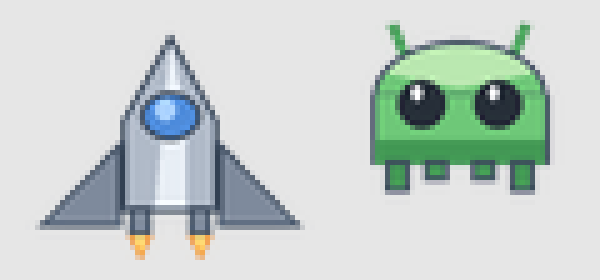
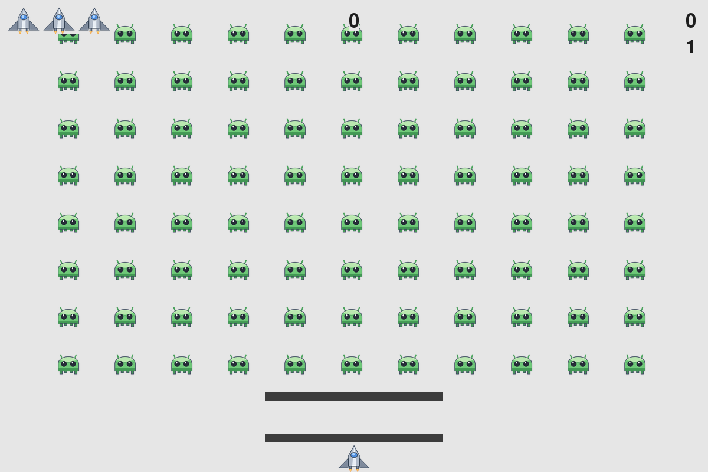
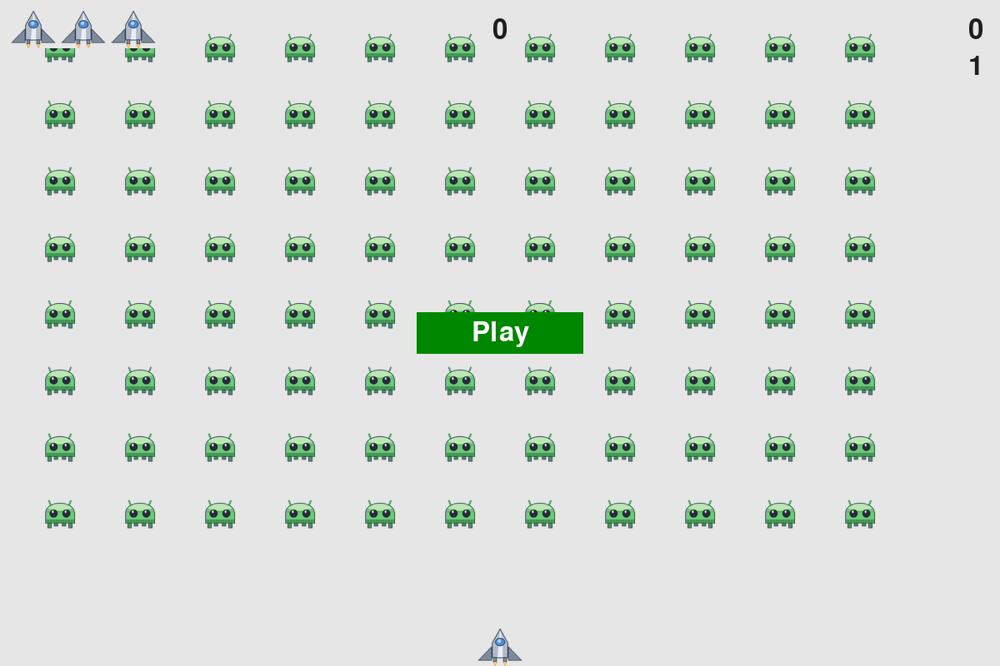
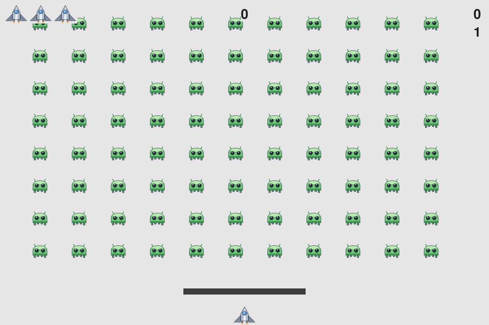
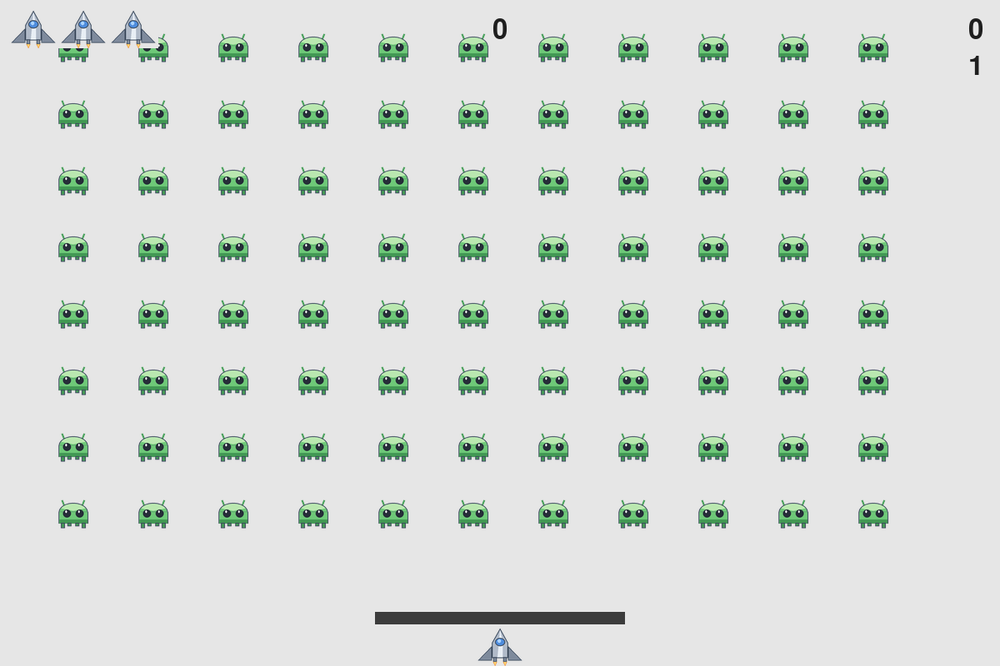
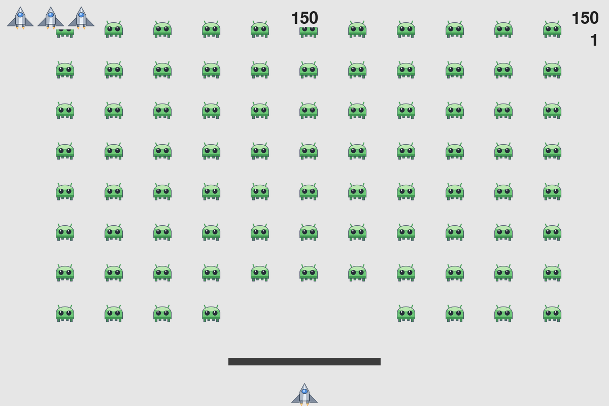
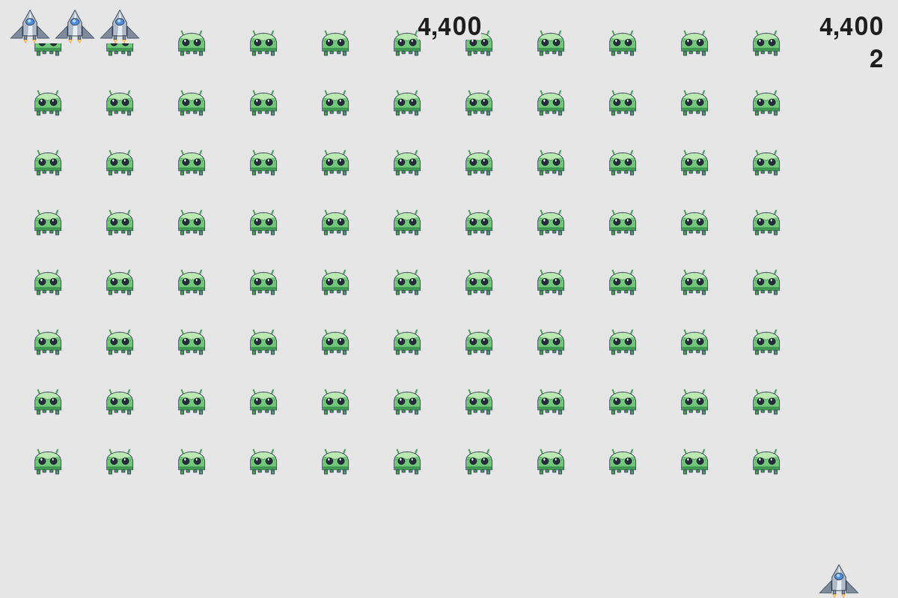
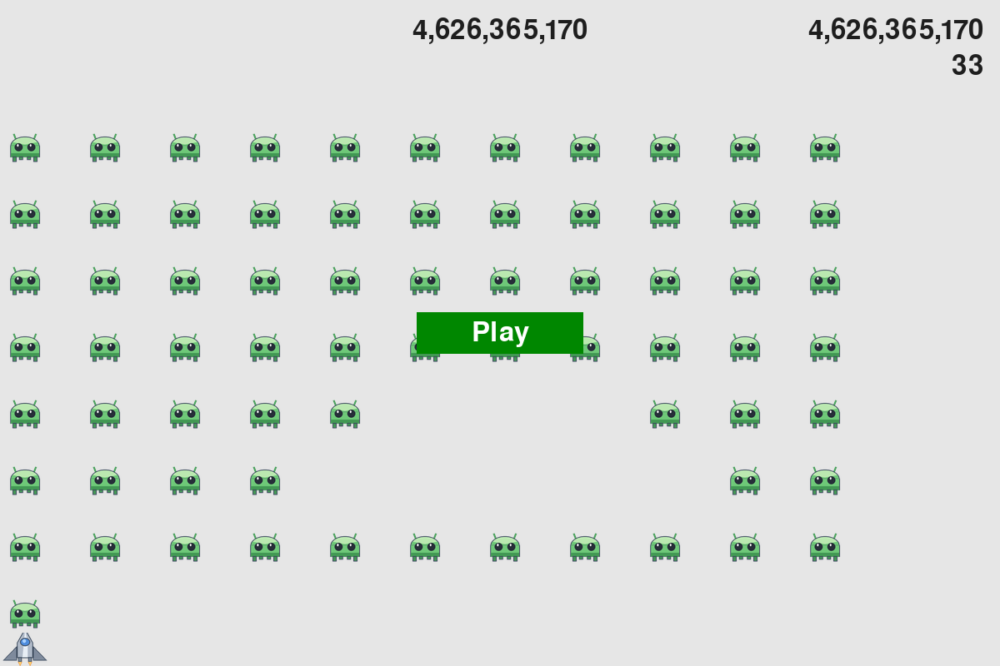
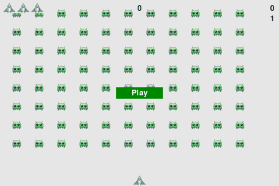

# 《外星人入侵》一步一步教学

> 配套教材：《Python 编程从入门到实践》（第 3 版）第 12～14 章
> 配套笔记：[../README.md](../README.md)（已整理的第 12～14 章要点 + 附录完整代码）
> 本文的定位：**README 讲「是什么」，本文讲「怎么做」** —— 从零开始，一步一步把这 8 个文件写出来、跑起来、测起来。

---

## 目录

- [第 0 步　先看清楚：我们手上有什么](#第-0-步先看清楚我们手上有什么)
- [第 1 步　环境搭建（含 3 个真实的坑）](#第-1-步环境搭建含-3-个真实的坑)
- [第 2 步　素材准备：ship.bmp 与 alien.bmp](#第-2-步素材准备shipbmp-与-alienbmp)
- [第 3 步　第 12 章 · 窗口骨架](#第-3-步第-12-章--窗口骨架)
- [第 4 步　第 12 章 · Settings：把数字集中管理](#第-4-步第-12-章--settings把数字集中管理)
- [第 5 步　第 12 章 · Ship：把飞船放上屏幕](#第-5-步第-12-章--ship把飞船放上屏幕)
- [第 6 步　第 12 章 · 驾驶飞船](#第-6-步第-12-章--驾驶飞船)
- [第 7 步　第 12 章 · 重构与退出](#第-7-步第-12-章--重构与退出)
- [第 8 步　第 12 章 · 射击](#第-8-步第-12-章--射击)
- [第 9 步　第 13 章 · 外星人与舰队](#第-9-步第-13-章--外星人与舰队)
- [第 10 步　第 13 章 · 让舰队动起来](#第-10-步第-13-章--让舰队动起来)
- [第 11 步　第 13 章 · 击落外星人](#第-11-步第-13-章--击落外星人)
- [第 12 步　第 13 章 · 结束游戏](#第-12-步第-13-章--结束游戏)
- [第 13 步　第 14 章 · Play 按钮](#第-13-步第-14-章--play-按钮)
- [第 14 步　第 14 章 · 难度递增](#第-14-步第-14-章--难度递增)
- [第 15 步　第 14 章 · 记分牌](#第-15-步第-14-章--记分牌)
- [第 16 步　收尾：测试、演示与打包](#第-16-步收尾测试演示与打包)
- [附录 A　Python 3.14 + pygame 的兼容说明](#附录-apython-314--pygame-的兼容说明)
- [附录 B　文件对照表：书 vs 本项目](#附录-b文件对照表书-vs-本项目)
- [附录 C　与教材的有意差异（共 12 处）](#附录-c与教材的有意差异共-12-处)
- [附录 D　调试手册](#附录-d调试手册)
- [附录 E　练习参考答案索引](#附录-e练习参考答案索引)

---

## 第 0 步　先看清楚：我们手上有什么

先跑三条命令，把现状摸清楚。**不要跳过这一步** —— 后面所有的坑都是从这里发现的。

```bash
cd alien_invasion
git log --oneline        # 提交历史
git ls-files             # 仓库里已跟踪的文件
cat pyproject.toml       # 工程配置
```

你会看到仓库里**只有 3 类东西**：

| 文件 | 作用 |
| --- | --- |
| `README.md` | 教材第 12～14 章的学习笔记 + 附录完整代码（2036 行） |
| `pyproject.toml` | 工程配置（uv 管理，声明了 `requires-python >=3.14`） |
| `src/alien_invasion/__init__.py` | 只有一个 `def main(): print("Hello from alien-invasion!")` |

**也就是说：游戏代码一行都还没有。** 那些「完整代码」只是 Markdown 里的文本，程序跑的是 `src/` 里的东西。这就是我们要做的事：

```
现在：  片段（README 里的文字）
目标：  能运行的包（src/alien_invasion/*.py）+ 能跑通的测试 + 能看的演示
```

### 0.1 本项目的目录规划

教材第 12.1 节说「所有文件必须放在同一个 `alien_invasion` 文件夹里」，本项目按现代 Python 项目习惯把「同一个文件夹」变成了一个**包**：

```
alien_invasion/
├── pyproject.toml              # 工程配置：依赖、入口脚本、测试配置
├── uv.lock                     # 依赖版本锁定（uv 自动生成，要提交）
├── .python-version             # 本机 Python 版本（3.14）
├── README.md                   # 教材笔记（已有，本文的姊妹篇）
├── docs/
│   ├── 教程.md                 # ← 本文
│   └── images/                 # 教程插图 + demo.gif（由 tools/record_demo.py 生成）
├── src/alien_invasion/         # ← 游戏本体（从第 3 步开始逐个创建）
│   ├── __init__.py             # 包的出口：导出 8 个类 + main
│   ├── __main__.py             # 让 `python -m alien_invasion` 能跑
│   ├── game.py                 # ← 书里的 alien_invasion.py
│   ├── settings.py             # ← Settings
│   ├── ship.py                 # ← Ship
│   ├── bullet.py               # ← Bullet
│   ├── alien.py                # ← Alien
│   ├── game_stats.py           # ← GameStats
│   ├── button.py               # ← Button
│   ├── scoreboard.py           # ← Scoreboard
│   └── images/{ship,alien}.bmp # 素材
├── tests/                      # pytest 测试（28 个，覆盖第 12～14 章全部逻辑）
└── tools/
    ├── make_sprites.py         # 生成素材
    ├── preview_server.py       # 浏览器实时预览（无显示器环境用）
    └── record_demo.py          # 自动驾驶录屏，生成教程插图
```

> 💡 **为什么不用书里的平铺结构？** 书里写成平铺是为了教学简单（不用讲 `import` 包、不用讲 `__init__.py`）。但在真项目里平铺会有两个问题：① 文件名容易和标准库/第三方库撞名；② 没法打包发布。本项目用的是「src 布局 + 相对导入」，本质内容和书里一模一样，只是文件放进了包目录。**看书时把 `game.py` 当成 `alien_invasion.py` 就好**（附录 B 有完整对照表）。

---

## 第 1 步　环境搭建（含 3 个真实的坑）

### 1.1 理论上的步骤（教材第 12.2 节）

```bash
python -m pip install --user pygame
```

### 1.2 本项目实际使用的命令（uv）

```bash
uv sync            # 按 pyproject.toml + uv.lock 建好 .venv 并装齐依赖
uv run alien-invasion   # 跑游戏
```

`uv sync` 比 `pip install` 多做三件事：把 Python 版本也管起来、把依赖版本锁进 `uv.lock`、依赖装在项目内的 `.venv` 而不是全局。

### 1.3 坑 ①：Python 3.14 装不上官方 pygame

`.python-version` 写的是 `3.14`，而 `pyproject.toml` 原本是 `requires-python = ">=3.14"`。但我去 PyPI 查了一下官方 `pygame` 2.6.1 的发行包：

```
pygame 2.6.1 提供的 wheel：cp310 cp311 cp312 cp313（最高到 Python 3.13）
pygame-ce 2.5.8 提供的 wheel：cp310 … cp314 cp315 ✅
```

**Python 3.14 没有对应的 wheel**，`pip install pygame` 会退化成「下载源码现场编译」，需要编译器 + SDL 开发库，十个里有九个失败。

**解决办法**（已写进 `pyproject.toml`）：

```toml
dependencies = [
    "pygame>=2.6.1; python_version < '3.14'",
    "pygame-ce>=2.5.8; python_version >= '3.14'",
]
```

`pygame-ce` 是「pygame 社区版」，API 与 `pygame` 完全兼容（`import pygame` 不变，`pygame.sprite.Group`、`pygame.font.SysFont` 全都在）。这样一份代码在两个 Python 版本上都能装、能跑。详见[附录 A](#附录-apython-314--pygame-的兼容说明)。

### 1.4 坑 ②：没有显示器就跑不起来

Pygame 默认会去连显示器。在没有图形界面的机器（服务器、容器、CI、本项目的沙箱）上运行会直接报错：

```
pygame.error: No available video device
```

**办法**：把 SDL 的视频驱动切成 `dummy`（画面画在内存里，不显示窗口）：

```bash
SDL_VIDEODRIVER=dummy uv run pytest        # 跑测试
SDL_VIDEODRIVER=dummy uv run python tools/record_demo.py   # 录屏
```

本项目把这一句直接写进了 `tests/conftest.py` 的最前面（**必须在 `import pygame` 之前设置**，否则不生效）和 `tools/*.py` 里，所以你不用每次手动敲。

### 1.5 坑 ③：图片找不到（`FileNotFoundError` / 图像不显示）

教材里写的是相对路径：

```python
self.image = pygame.image.load('images/ship.bmp')   # 书里的写法
```

这条路径是相对**当前工作目录**的，所以只有在 `alien_invasion/` 文件夹里运行才有效。你一旦在别处执行（比如 IDE 的 Run 按钮、`pytest` 从上层目录运行）就会失败。

**本项目的写法**（`settings.py`）：

```python
from pathlib import Path

IMAGES_DIR = Path(__file__).resolve().parent / "images"   # 相对「本文件」而不是「当前目录」
```

然后 `pygame.image.load(str(IMAGES_DIR / "ship.bmp"))`。这样无论从哪个目录启动都能找到图片。已验证：

```bash
cd /tmp && SDL_VIDEODRIVER=dummy /path/to/.venv/bin/python -m alien_invasion   # 正常
```

### 1.6 环境搭好了，验证一下

```bash
uv run python -c "import pygame; print(pygame.version.ver)"
# 2.6.1
```

如果这一步过了，就可以进入第 2 步。

---

## 第 2 步　素材准备：ship.bmp 与 alien.bmp

教材第 12.4 节讲了选图的三个要点：

1. **注意版权**（推荐 OpenGameArt 等免费素材站）；
2. **用 .bmp 最省事**，jpg/png 先转成 bmp；
3. **图像背景色要和游戏背景色一致**（都是浅灰 `(230,230,230)`），这样飞船看起来是「贴」在屏幕上而不是「贴了一张纸」。

本项目用的是脚本画的素材，好处是随机改配色重跑即可，也不用操心版权：

```bash
uv run python tools/make_sprites.py
# 已生成 src/alien_invasion/images/ship.bmp  (60x48, 8694 字节)
# 已生成 src/alien_invasion/images/alien.bmp (48x40, 5814 字节)
```



> 图中是放大 5 倍的效果（预览图由 `--preview` 参数生成）。真正的素材是 60×48 和 48×40 的小图 —— 尺寸与教材一致。

**如果你自己找图**，请确认：

- 尺寸差不多（飞船 60×48、外星人 48×40 左右，改尺寸要去改 `Settings`）；
- 背景色是 `(230,230,230)`；不是的话用画图/PS 填充一下；
- 用 Pillow 检查背景色（`tools/make_sprites.py` 里就是这么自测的）：
  ```python
  from PIL import Image
  print(Image.open("images/ship.bmp").getpixel((0, 0)))   # 应该是 (230, 230, 230)
  ```

**检查点**：`src/alien_invasion/images/` 下有这两个 bmp 文件，用图片查看器打开能看到飞船和外星人。

---

## 第 3 步　第 12 章 · 窗口骨架

教材第 12.3 节。目标：**打开一个 1200×800 的浅灰色窗口，点关闭能退出**。

### 3.1 最小可运行版本

先建 `src/alien_invasion/game.py`：

```python
import sys
import pygame


class AlienInvasion:
    """管理游戏资源和行为的类"""

    def __init__(self):
        """初始化游戏并创建游戏资源"""
        pygame.init()                                     # 初始化背景
        self.screen = pygame.display.set_mode((1200, 800))  # 创建显示窗口
        pygame.display.set_caption("Alien Invasion")

    def run_game(self):
        """开始游戏的主循环"""
        while True:
            # 侦听键盘和鼠标事件
            for event in pygame.event.get():
                if event.type == pygame.QUIT:
                    sys.exit()
            # 让最近绘制的屏幕可见
            pygame.display.flip()


if __name__ == '__main__':
    ai = AlienInvasion()
    ai.run_game()
```

运行：`uv run python -m alien_invasion`（此时 `__main__.py` 和 `main()` 还没写，可以先直接 `uv run python src/alien_invasion/game.py`）。

**这里四个概念必须搞清楚**（教材第 12.3.1 节）：

| 概念 | 说明 |
| --- | --- |
| `surface` | Pygame 里「屏幕的一部分」。窗口本身是一个 surface，飞船/外星人/文字也都是 surface。理解它，后面 `blit` 就顺了 |
| 事件 | 用户做的事（按键、移鼠标、关窗口）。`pygame.event.get()` 返回「上次调用之后发生的所有事件」 |
| 主循环 | `while True` 里做三件事：**读输入 → 更新状态 → 重绘**。所有游戏都是这个结构 |
| `display.flip()` | 我们是在「另一块画布」上绘制，`flip()` 才把它推到屏幕上。少了这句，你会看到一个纯黑窗口 |

### 3.2 控制帧率

```python
self.clock = pygame.time.Clock()    # __init__ 里
...
self.clock.tick(60)                 # while 循环末尾
```

`tick(60)` 做两件事：限制循环最多跑 60 次/秒，并返回上一帧用了多少毫秒（所以它**不只是**节流）。

> ⚠️ 忘了 `tick()` → 循环以 CPU 极限速度狂转，风扇起飞，移动速度也随机器性能变化。

### 3.3 背景色

```python
self.bg_color = (230, 230, 230)     # RGB，每个分量 0~255
self.screen.fill(self.bg_color)     # fill() 只接受一个颜色参数
```

### 3.4 检查点

```bash
uv run alien-invasion     # 或 uv run python -m alien_invasion
```

- [ ] 弹出一个 1200×800 的浅灰色窗口，标题是 `Alien Invasion`
- [ ] 点窗口右上角 ✕ 能退出
- [ ] 观察 CPU 占用应该很低（`tick(60)` 生效了）

---

## 第 4 步　第 12 章 · Settings：把数字集中管理

教材第 12.3.4 节。新建 `src/alien_invasion/settings.py`：

```python
from pathlib import Path

# 素材目录：相对本文件定位，而不是当前工作目录（见第 1.5 节）
IMAGES_DIR = Path(__file__).resolve().parent / "images"


class Settings:
    """存储游戏《外星人入侵》中所有设置的类"""

    def __init__(self):
        # 屏幕设置
        self.screen_width = 1200
        self.screen_height = 800
        self.bg_color = (230, 230, 230)
        # ...
```

然后在 `game.py` 里把硬编码的数字换掉：

```python
self.settings = Settings()
self.screen = pygame.display.set_mode(
    (self.settings.screen_width, self.settings.screen_height))
```

**为什么值得为「几个数字」单独建一个类？** 因为写到第 14 章时你会有 20 多个可调参数（速度、子弹上限、加分倍率……），散落在 8 个文件里的话，调平衡会变成噩梦。教材的这个「基建」在第 14 章「难度递增」时会体现出价值：`increase_speed()` 只需要改这一个类里的数字。

本项目还在 `Settings` 里多放了两个后面才用到的属性（`fps`、`high_score_file`），以及 `IMAGES_DIR` 这个常量 —— 这些都是为了让「魔法数字」有名字。

**检查点**：窗口尺寸和颜色没有变化（重构不该改变行为）。跑 `uv run pytest tests/test_game.py::TestChapter12::test_settings_defaults -q` 看参数是否与预期一致。

---

## 第 5 步　第 12 章 · Ship：把飞船放上屏幕

教材第 12.4 节。新建 `src/alien_invasion/ship.py`：

```python
import pygame


class Ship:
    """管理飞船的类"""

    def __init__(self, ai_game):
        """初始化飞船并设置其初始位置"""
        self.screen = ai_game.screen
        self.settings = ai_game.settings
        self.screen_rect = ai_game.screen.get_rect()

        # 加载飞船图像并获取其外接矩形
        self.image = pygame.image.load(str(IMAGES_DIR / "ship.bmp"))
        self.rect = self.image.get_rect()

        # 每艘新飞船都放在屏幕底部的中央
        self.rect.midbottom = self.screen_rect.midbottom

    def blitme(self):
        """在指定位置绘制飞船"""
        self.screen.blit(self.image, self.rect)
```

### 5.1 三个必须记住的点

**① `ai_game` 参数**：每个游戏元素都要访问主控对象（拿屏幕、拿设置）。教材的做法是构造时把主实例传进去，元素自己存下需要的引用。这是本项目类之间唯一的耦合方式，简单有效。

**② rect 的定位属性**：`rect` 是「外接矩形」，它自己不会移动飞船，但通过它设置位置最方便。

| 类别 | 属性 |
| --- | --- |
| 定位 | `x`、`y`（左上角）、`center`、`centerx`、`centery` |
| 边缘 | `top`、`bottom`、`left`、`right` |
| 组合 | `midbottom`、`midtop`、`midleft`、`midright` |

**坐标系注意**：原点 `(0, 0)` 在**左上角**，y 向下增大。1200×800 的屏幕右下角是 `(1200, 800)`。

**③ `blit()` 的顺序就是绘制的图层顺序**：先画的在下面。所以 `_update_screen()` 里的顺序必须是「背景 → 子弹 → 飞船 → 外星人 → 记分牌 → 按钮」。

### 5.2 接到主程序里

```python
# game.py 的 __init__ 里
self.ship = Ship(self)

# _update_screen() 里（在 fill 之后）
self.ship.blitme()
```

**检查点**：窗口底部中央出现一艘飞船。

> 📌 **常见错误**：`ImportError: attempted relative import with no known parent package`
> 原因：在包内写的是 `from .settings import IMAGES_DIR`，却用 `python src/alien_invasion/game.py` 直接运行这个文件（此时它不是一个包里的模块）。解决：用 `uv run python -m alien_invasion`，或者先把 `__main__.py` 建好。

---

## 第 6 步　第 12 章 · 驾驶飞船

教材第 12.6 节。顺序很重要：先「能动」再「能持续动」再「能变速」再「不许出界」。

### 6.1 第一步：按下就动一下（12.6.1）

```python
elif event.type == pygame.KEYDOWN:
    if event.key == pygame.K_RIGHT:
        self.ship.rect.x += 1
```

能跑，但按一下只挪 1 像素，手感极差。

### 6.2 第二步：移动标志（12.6.2）

关键洞察：**事件是「瞬间」的（按下/松开各一次），而移动是「持续」的**。所以用一个布尔标志当桥梁：

```python
# Ship.__init__
self.moving_right = False
self.moving_left = False

# Ship.update
if self.moving_right:
    self.rect.x += 1

# AlienInvasion._check_keydown_events
if event.key == pygame.K_RIGHT:
    self.ship.moving_right = True
# AlienInvasion._check_keyup_events
if event.key == pygame.K_RIGHT:
    self.ship.moving_right = False
```

主循环里在「检测事件之后、更新屏幕之前」调用 `self.ship.update()`。这个位置不能错：事件改标志 → update 读标志 → 屏幕反映结果。

### 6.3 第三步：左右移动（12.6.3）

`ship.update()` 里**必须用两个独立的 `if`，不能用 `elif`**：

```python
if self.moving_right:
    self.x += self.settings.ship_speed
if self.moving_left:
    self.x -= self.settings.ship_speed
```

用 `elif` 的话，同时按住左右键时只有一边生效，飞船会一直往一个方向漂。用两个 `if` 则「先加后减」，飞船原地不动 —— 更符合直觉。

### 6.4 第四步：精确速度（12.6.4）

问题：`rect` 只能存**整数**，速度想设 1.5 就丢了 0.5，飞船会一顿一顿地跳 1 像素。教材的解法是「**双份记录**」：

```python
# __init__
self.x = float(self.rect.x)      # 用浮点数保存精确位置

# update
self.x += self.settings.ship_speed
self.rect.x = self.x             # 用浮点数去更新 rect
```

这个套路在本项目里用了三次（Ship、Bullet、Alien），是全书最实用的小技巧之一。

### 6.5 第五步：不许出界（12.6.5）

```python
if self.moving_right and self.rect.right < self.screen_rect.right:
    self.x += self.settings.ship_speed
if self.moving_left and self.rect.left > 0:
    self.x -= self.settings.ship_speed
```

边界判断写在条件里，飞船到边缘就「像撞墙一样停住」。

**检查点**（对应测试 `TestChapter12::test_ship_stops_at_screen_edges`）：

- [ ] ← → 能左右移动，松手就停
- [ ] 同时按住左右，飞船原地不动
- [ ] 一直按右不放，飞船停在屏幕右边缘（不会消失）

---

## 第 7 步　第 12 章 · 重构与退出

教材第 12.5、12.6.6、12.6.7 节。**重构不是「改坏了再修」，而是「趁还能看懂的时候整理」**。

### 7.1 拆分主循环

`run_game()` 一开始什么都往里塞，现在按职责拆开：

```python
def run_game(self):
    while True:
        self._check_events()      # 处理输入
        self._update_screen()     # 重绘
        self.clock.tick(60)       # 控制节奏
```

### 7.2 拆分事件处理

```python
def _check_events(self):
    """响应按键和鼠标事件"""
    for event in self.event_source():
        if event.type == pygame.QUIT:
            self.quit()
        elif event.type == pygame.KEYDOWN:
            self._check_keydown_events(event)
        elif event.type == pygame.KEYUP:
            self._check_keyup_events(event)

def _check_keydown_events(self, event):
    """响应按下"""
    if event.key == pygame.K_RIGHT:
        self.ship.moving_right = True
    elif event.key == pygame.K_LEFT:
        self.ship.moving_left = True
    elif event.key == pygame.K_q:
        self.quit()

def _check_keyup_events(self, event):
    """响应释放"""
    if event.key == pygame.K_RIGHT:
        self.ship.moving_right = False
    elif event.key == pygame.K_LEFT:
        self.ship.moving_left = False
```

**命名约定**（教材第 2.4 节）：只在类内部调用的辅助方法以**单下划线**开头（`_check_events`），对外提供的方法不加下划线（`update`、`blitme`、`run_game`）。这是 Python 社区的通用信号，读代码的人一眼就知道哪些是内部实现。

### 7.3 按 Q 退出（12.6.7）

```python
elif event.key == pygame.K_q:
    self.quit()
```

> ⚠️ **本项目的写法与教材略有不同**：书里直接 `sys.exit()`，本项目的 `quit()` 只是 `self.running = False`。区别在于：`sys.exit()` 会抛 `SystemExit` 异常，把整个程序连根拔起，测试和外部驱动就没法「干净地收尾」了。用标志位来控制循环是更工程化的做法（详见[附录 C](#附录-c与教材的有意差异共-12-处)）。

### 7.4 全屏模式（12.6.8）

```python
self.screen = pygame.display.set_mode((0, 0), pygame.FULLSCREEN)
self.settings.screen_width = self.screen.get_rect().width
self.settings.screen_height = self.screen.get_rect().height
```

⚠️ 全屏前**务必确认 Q 键退出可用** —— Pygame 全屏下没有默认退出方式，卡住了只能 `Ctrl+Alt+F1` 切终端 kill 进程。

### 7.5 `pygame.event.get()` vs 自定义事件源

教材写的是 `pygame.event.get()`。本项目改成：

```python
self.event_source = event_source or pygame.event.get
...
for event in self.event_source():
```

默认行为完全一样，但**可以注入假事件**了 —— 这正是 `tests/` 和 `tools/preview_server.py`（浏览器里玩）能工作的基础。这是本项目给游戏开的第一个「测试接缝」。

**检查点**：`uv run python -m pytest tests/test_game.py::TestChapter12 -q` 全绿（含 Q 键退出、边界限制）。

---

## 第 8 步　第 12 章 · 射击

教材第 12.8 节。

### 8.1 子弹设置

```python
# settings.py
self.bullet_speed = 2.0      # 注意：第 14 章会被移到 initialize_dynamic_settings()
self.bullet_width = 3
self.bullet_height = 15
self.bullet_color = (60, 60, 60)
self.bullets_allowed = 3
```

### 8.2 Bullet 类：第一个 Sprite

新建 `src/alien_invasion/bullet.py`：

```python
from pygame.sprite import Sprite


class Bullet(Sprite):
    """管理飞船所发射子弹的类"""

    def __init__(self, ai_game):
        super().__init__()
        self.screen = ai_game.screen
        self.settings = ai_game.settings
        self.color = self.settings.bullet_color

        # 在 (0, 0) 处创建矩形，再搬运到飞船顶部
        self.rect = pygame.Rect(0, 0, self.settings.bullet_width,
                                self.settings.bullet_height)
        self.rect.midtop = ai_game.ship.rect.midtop

        self.y = float(self.rect.y)      # 又是「双份记录」

    def update(self):
        self.y -= self.settings.bullet_speed
        self.rect.y = self.y

    def draw_bullet(self):
        pygame.draw.rect(self.screen, self.color, self.rect)
```

**两个要点**：

- **子弹没有图片**，用 `pygame.Rect(0, 0, w, h)` 从零造矩形，再用 `pygame.draw.rect()` 画出来。这是「用几何图形当精灵」的标准做法。
- **继承 `Sprite`** 是为了能进 `Group`，从而白拿三个能力：批量 `update()`、批量 `draw()`、碰撞检测。

### 8.3 开火与批量更新

```python
# game.py 的 __init__
self.bullets = pygame.sprite.Group()

def _fire_bullet(self):
    """创建一颗子弹，并将其加入编组 bullets"""
    if len(self.bullets) < self.settings.bullets_allowed:
        new_bullet = Bullet(self)
        self.bullets.add(new_bullet)

def _update_bullets(self):
    """更新子弹的位置并删除已消失的子弹"""
    self.bullets.update()        # 对编组里每个精灵调用 .update()

    # 删除已消失的子弹：遍历副本！
    for bullet in self.bullets.copy():
        if bullet.rect.bottom <= 0:
            self.bullets.remove(bullet)
```

```python
# _check_keydown_events 里
elif event.key == pygame.K_SPACE:
    self._fire_bullet()

# _update_screen 里（飞船之前）
for bullet in self.bullets.sprites():
    bullet.draw_bullet()
```

### 8.4 两个坑

**坑 ①：`for bullet in self.bullets:` 里删元素**。Python 不允许在遍历中修改被遍历的容器，Pygame 的 `Group` 也一样。必须先 `self.bullets.copy()` 拿一份快照再删。

**坑 ②：子弹要画在飞船之前**。`_update_screen()` 里先画子弹、后画飞船，子弹才会「从飞船里射出来」；反过来就是子弹压在飞船上面（正面飞出来的子弹看着很怪）。

> 💡 **调试技巧**（教材 13.5 提到，本项目截图见下）：把 `bullet_width` 临时改成 300，子弹变成一根横条，一打一片，方便快速验证计分和升级逻辑。
> 

**检查点**（`TestChapter12::test_fire_bullet_respects_limit` / `test_bullet_flies_up_and_is_removed`）：

- [ ] 按空格发射子弹，最多同时 3 颗
- [ ] 子弹飞出屏幕顶部后消失（用 `len(game.bullets)` 检查，别只看画面）

---

## 第 9 步　第 13 章 · 外星人与舰队

教材第 13.2、13.3 节。

### 9.1 Alien 类

新建 `src/alien_invasion/alien.py`，结构与 `Ship` 几乎一样（`Sprite` + 双份记录）：

```python
class Alien(Sprite):
    def __init__(self, ai_game):
        super().__init__()
        self.screen = ai_game.screen
        self.settings = ai_game.settings
        self.image = pygame.image.load(str(IMAGES_DIR / "alien.bmp"))
        self.image = self.image.convert()
        self.rect = self.image.get_rect()
        self.rect.x = self.rect.width      # 先随便放左上角，舰队会重新排
        self.rect.y = self.rect.height
        self.x = float(self.rect.x)

    def update(self):
        self.x += self.settings.alien_speed * self.settings.fleet_direction
        self.rect.x = self.x

    def check_edges(self):
        screen_rect = self.screen.get_rect()
        return (self.rect.right >= screen_rect.right) or (self.rect.left <= 0)
```

**`update()` 里那个乘法是关键**：`alien_speed * fleet_direction`，方向为 1 就每帧往右 1 像素，为 -1 就往左。**一行代码实现「整队左右摆动」** —— 这就是为什么要用「方向标志」而不是给每个外星人单独记方向。

### 9.2 铺舰队：`_create_fleet()` 的嵌套循环

```python
def _create_fleet(self):
    alien = Alien(self)                       # 临时的，只用来量尺寸
    alien_width, alien_height = alien.rect.size

    current_x, current_y = alien_width, alien_height
    while current_y < (self.settings.screen_height - 3 * alien_height):
        while current_x < (self.settings.screen_width - 2 * alien_width):
            self._create_alien(current_x, current_y)
            current_x += 2 * alien_width

        # ⬇⬇ 这两行属于外层循环！缩进错了舰队就排成一斜线
        current_x = alien_width
        current_y += 2 * alien_height
```

**教材第 13.3.2 节专门提醒过这个坑**：如果把「重置 x、递增 y」写进内层循环，外星人就会排成一条歪斜的长龙。判断方法：看内层循环体里有没有「重置 `current_x`」这一行 —— 有就是错的。

**为什么 x 的步长是 `2 * alien_width`？** 这样两列外星人之间正好空一个外星人的宽度，看起来是整齐的网格。

**检查点**（`TestChapter13::test_fleet_is_created_in_grid`）：

- [ ] 满屏外星人，行距列距均匀
- [ ] 数一数：1200 宽正好排 11 列（x = 48, 144, …, 1008），800 高 8 行，共 **88 个**外星人

---

## 第 10 步　第 13 章 · 让舰队动起来

教材第 13.4 节。

```python
def _update_aliens(self):
    """检查是否有外星人位于屏幕边缘，并更新整个外星舰队的位置"""
    self._check_fleet_edges()
    self.aliens.update()

def _check_fleet_edges(self):
    """在有外星人到达边缘时采取相应的措施"""
    for alien in self.aliens.sprites():
        if alien.check_edges():
            self._change_fleet_direction()
            break                    # ⬅ 找到一个就够了，别让整队下移多次

def _change_fleet_direction(self):
    """将整个外星舰队向下移动，并改变它们的方向"""
    for alien in self.aliens.sprites():
        alien.rect.y += self.settings.fleet_drop_speed
    self.settings.fleet_direction *= -1
```

**三个细节**：

1. **`break` 不能少**。如果有 5 个外星人同时贴边，没有 `break` 就会下移 5 次（一次 50 像素）并反转方向 5 次（等于没反转）。
2. **方向存在 `settings` 而不是 `alien` 上**，因为这是「整个舰队」的属性。
3. **`alien.rect.y += 10` 而不是 `alien.y += 10`**：这里直接改 rect 就够了，因为垂直方向不涉及「每帧累加的浮点速度」，只是偶发的一次位移。

主循环里接上：

```python
if self.game_active:
    self.ship.update()
    self._update_bullets()
    self._update_aliens()
```

> ⚠️ `self.game_active` 要到第 13 步才存在。在此之前，第 12 步的开发顺序是直接调用这三个方法（教材第 13.5 节之前的写法）。

**检查点**（`TestChapter13::test_fleet_drops_and_reverses_at_edge`）：

- [ ] 舰队整体左右移动
- [ ] 撞到边缘后整队下移，然后反向
- [ ] 方向反转**只发生一次**（可以在 `_change_fleet_direction` 里临时 `print` 验证，验证完记得删掉 —— 教材提醒过 `print` 多了比绘图还慢）

---

## 第 11 步　第 13 章 · 击落外星人

教材第 13.5 节。这一步是全书第一个「高光时刻」：

```python
def _check_bullet_alien_collisions(self):
    """响应子弹和外星人的碰撞"""
    # 一行代码完成「找出所有碰撞 + 删掉子弹 + 删掉外星人」
    collisions = pygame.sprite.groupcollide(self.bullets, self.aliens, True, True)

    if not self.aliens:
        # 舰队被清空 → 生成新舰队 + 提速
        self.bullets.empty()
        self._create_fleet()
        self.settings.increase_speed()
```

`groupcollide(group1, group2, dokill1, dokill2)` 的两个布尔参数决定「撞上后谁死」：子弹和外星人都设 `True`，两边同时删除。

在我们加了记分之后（第 14 章），它还需要处理返回值：

```python
if collisions:
    for aliens in collisions.values():
        self.stats.score += self.settings.alien_points * len(aliens)
```

**返回的是一个字典** `{子弹对象: [被这发子弹击中的外星人, ...]}`，因为一发子弹可能同时打中多个外星人（还记得宽子弹调试吗）。所以加分要按 `len(aliens)` 加，**不能简单地加一次分**。

**检查点**（`TestChapter13::test_bullet_kills_alien_and_scores`、`TestChapter13::test_one_bullet_can_kill_several_aliens`）：

- [ ] 子弹打到外星人，两者都消失
- [ ] 可以试试把 `bullet_width = 300` 打一整排，验证「一发多杀」的计分逻辑

---

## 第 12 步　第 13 章 · 结束游戏

教材第 13.6 节。先加统计类（为第 14 章的记分牌做准备）：

`src/alien_invasion/game_stats.py`：

```python
class GameStats:
    """跟踪游戏的统计信息"""

    def __init__(self, ai_game):
        self.settings = ai_game.settings
        self.reset_stats()
        self.high_score = 0        # 最高分不能放进 reset_stats()！

    def reset_stats(self):
        """初始化在游戏运行期间可能变化的统计信息"""
        self.ships_left = self.settings.ship_limit
        self.score = 0
        self.level = 1
```

> 📌 **教材第 14.3.3 节的坑**：`high_score` 必须写在 `__init__()` 里、**不能**写进 `reset_stats()`。写进去的话，每重开一局最高分就归零。

然后是碰撞与结束：

```python
# _update_aliens() 里追加
if pygame.sprite.spritecollideany(self.ship, self.aliens):
    self._ship_hit()
self._check_aliens_bottom()

def _check_aliens_bottom(self):
    """检查是否有外星人到达了屏幕的下边缘"""
    for alien in self.aliens.sprites():
        if alien.rect.bottom >= self.settings.screen_height:
            self._ship_hit()      # 和外星人撞到飞船一样处理
            break

def _ship_hit(self):
    """响应飞船和外星人的碰撞"""
    self.stats.ships_left -= 1
    self.sb.prep_ships()
    if self.stats.ships_left > 0:
        self.bullets.empty()
        self.aliens.empty()
        self._create_fleet()
        self.ship.center_ship()
        sleep(0.5)                # 暂停，让玩家反应过来
    else:
        self.game_active = False
        pygame.mouse.set_visible(True)
```

### ⚠️ 教材这里有一个 off-by-one 的 bug

书里写的是：

```python
if self.stats.ships_left > 0:      # 先判断
    self.stats.ships_left -= 1     # 再减 1
    ...
else:
    self.game_active = False
```

推演一下（初始 3 艘）：

| 第几次被撞 | 判断 `ships_left > 0` | 减 1 之后 | 游戏结束？ |
| --- | --- | --- | --- |
| 1 | 3 > 0 ✅ | 2 | 否 |
| 2 | 2 > 0 ✅ | 1 | 否 |
| 3 | 1 > 0 ✅ | **0** | **否** ❌ |
| 4 | 0 > 0 ❌ | 0 | 是 |

**第 3 次被撞后飞船数已经是 0，但游戏还在继续**，要第 4 次才结束 —— 等于白送一条命，而且记分牌上已经显示 0 艘飞船了，看起来像 bug。

**改法**：先减 1，再判断：

```python
self.stats.ships_left -= 1      # 先扣命
self.sb.prep_ships()
if self.stats.ships_left > 0:   # 再判断还有没有
    ...重置...
else:
    self.game_active = False
```

本项目还顺手加了 `self.sb.prep_ships()`：让记分牌上的小飞船图标立刻同步（教材原版是等到 `_start_game` 重排时才更新）。

**检查点**（`TestChapter13::test_game_over_after_three_hits`、`test_alien_reaching_bottom_costs_a_ship`）：被撞 3 次后游戏结束、光标重新出现、还能再点 Play 重开。

---

## 第 13 步　第 14 章 · Play 按钮

教材第 14.1 节。

### 13.1 Button 类

新建 `src/alien_invasion/button.py`。核心是**「渲染一次，反复 blit」**：

```python
class Button:
    def __init__(self, ai_game, msg):
        self.screen = ai_game.screen
        self.screen_rect = self.screen.get_rect()
        self.width, self.height = 200, 50
        self.button_color = (0, 135, 0)
        self.text_color = (255, 255, 255)
        self.font = pygame.font.SysFont(None, 48)
        self.rect = pygame.Rect(0, 0, self.width, self.height)
        self.rect.center = self.screen_rect.center
        self._prep_msg(msg)               # 标签只渲染一次

    def _prep_msg(self, msg):
        self.msg_image = self.font.render(msg, True, self.text_color, self.button_color)
        self.msg_image_rect = self.msg_image.get_rect()
        self.msg_image_rect.center = self.rect.center

    def draw_button(self):
        self.screen.fill(self.button_color, self.rect)
        self.screen.blit(self.msg_image, self.msg_image_rect)
```

**为什么文字要预渲染？** `font.render()` 要把字形栅格化成一张图片，很贵。每帧调用一次（60fps）就是每秒 60 次无谓的渲染。所有「不会变的东西」都应该预先画好，主循环里只做 `blit`。

### 13.2 开始游戏的完整流程

```python
# _check_events 里
elif event.type == pygame.MOUSEBUTTONDOWN:
    self._check_play_button(event.pos)      # 用事件自带的位置

def _check_play_button(self, mouse_pos):
    """在玩家单击 Play 按钮时开始新游戏"""
    button_clicked = self.play_button.rect.collidepoint(mouse_pos)
    if button_clicked and not self.game_active:      # ⬅ 两个条件缺一不可
        self._start_game()

def _start_game(self):
    """重置一切，开始新的一局"""
    self.settings.initialize_dynamic_settings()   # 难度复位
    self.stats.reset_stats()                      # 分数/等级/飞船数复位
    self.sb.prep_score()
    self.sb.prep_level()
    self.sb.prep_ships()
    self.bullets.empty()
    self.aliens.empty()
    self._create_fleet()
    self.ship.center_ship()
    self.game_active = True
    pygame.mouse.set_visible(False)               # 隐藏光标
```

三个必须记住的点：

| 点 | 说明 |
| --- | --- |
| `and not self.game_active` | 少了它 → **点屏幕任意位置都能重开游戏**，而且游戏中乱点会把分数清零（教材第 14.1.4 节踩过的坑） |
| `initialize_dynamic_settings()` | 少了它 → 第二局一开局就是上一局的高速难度 |
| `prep_*()` 三连 | 少了它 → 新一局开始时记分牌还显示上一局的分数 |

### 13.3 练习 14.1：按 P 键也能开始

教材的练习要求「把 `_check_play_button()` 里的代码提取成 `_start_game()`」。本项目已经这么做了，于是 P 键只需三行：

```python
elif event.key == pygame.K_p:
    if not self.game_active:
        self._start_game()
```

**检查点**（`TestChapter14` 里的 4 个测试）：

- [ ] 启动后是「非活动」状态，屏幕中央有绿色 Play 按钮
- [ ] 点 Play 或按 P 开始游戏，光标消失
- [ ] 点别的地方没反应
- [ ] 结束后点 Play 能重开，分数/等级/难度全部复位

---

## 第 14 步　第 14 章 · 难度递增

教材第 14.2 节。这一步把 `Settings` 拆成「静态」和「动态」两组：

```python
class Settings:
    def __init__(self):
        # ...静态设置（屏幕、子弹尺寸、飞船数量、speedup_scale...）
        self.speedup_scale = 1.1        # 每升一级速度乘 1.1
        self.score_scale = 1.5          # 每升一级分值乘 1.5
        self.initialize_dynamic_settings()      # ⬅ 必须最后调用

    def initialize_dynamic_settings(self):
        """初始化随游戏进行而变化的设置"""
        self.ship_speed = 1.5
        self.bullet_speed = 2.5
        self.alien_speed = 1.0
        self.fleet_direction = 1        # 1 向右，-1 向左
        self.alien_points = 50

    def increase_speed(self):
        """提高速度设置的值和外星人的分值"""
        self.ship_speed *= self.speedup_scale
        self.bullet_speed *= self.speedup_scale
        self.alien_speed *= self.speedup_scale
        self.alien_points = int(self.alien_points * self.score_scale)
```

**怎么区分静态和动态？** 一句话：**「重开一局时要不要还原」**。要还原的（速度、方向、分值）就是动态设置，必须由 `initialize_dynamic_settings()` 负责初始化。

然后在「舰队被清空」时提高难度：

```python
def _start_new_level(self):
    """清空舰队、生成新的、提升难度与等级（教材练习 14.6）"""
    self.bullets.empty()
    self._create_fleet()
    self.settings.increase_speed()
    self.stats.level += 1
    self.sb.prep_level()
```

**难度曲线感受**（`alien_points` 50 起，每级 ×1.5）：

| 等级 | 外星人速度 | 每个外星人分值 |
| --- | --- | --- |
| 1 | 1.00 | 50 |
| 2 | 1.10 | 75 |
| 3 | 1.21 | 112 |
| 4 | 1.33 | 168 |
| 5 | 1.46 | 252 |
| 10 | 2.36 | 1,912 |
| 15 | 3.80 | 14,518 |
| 20 | 6.12 | 110,242 |

> 📌 这张表不是估算的，是用真代码跑出来的（`increase_speed()` 连续调用 19 次）。
> 注意 `alien_points = int(alien_points * score_scale)` 每次都**向下取整**，
> 所以是 50 → 75 → 112（不是 112.5）→ 168 …… 自己推的时候别用浮点数硬算。

指数增长很快，所以真实游玩时 10 级以后基本就是「手速的极限」了。（本项目用来录屏的自动驾驶跑到了 33 级、46 亿分。）

**检查点**（`TestChapter14::test_difficulty_scales_with_level`）：清空舰队后等级 +1、速度变快、分值变大；重开一局后回到 1.0 / 50。

---

## 第 15 步　第 14 章 · 记分牌

教材第 14.3 节。新建 `src/alien_invasion/scoreboard.py`。

### 15.1 准备四张「图像」

教材的命名规律是 `prep_xxx()`（prepare）：**把「数据」变成「可以 blit 的图像 + 位置」**，主循环里只负责贴上去。

```python
def prep_score(self):
    """将得分渲染为图像"""
    rounded_score = round(self.stats.score, -1)     # 精确到十位
    score_str = f"{rounded_score:,}"                # 1234567 → 1,234,570
    self.score_image = self.font.render(score_str, True,
                                        self.text_color, self.settings.bg_color)
    self.score_rect = self.score_image.get_rect()
    self.score_rect.right = self.screen_rect.right - 20
    self.score_rect.top = 20
```

四个位置分别对应：

| 元素 | 方法 | 位置 |
| --- | --- | --- |
| 得分 | `prep_score()` | 右上角，`right = screen.right - 20`、`top = 20` |
| 最高分 | `prep_high_score()` | 顶部居中，与得分同一行 |
| 等级 | `prep_level()` | 得分正下方（`top = score_rect.bottom + 10`） |
| 剩余飞船 | `prep_ships()` | 左上角一排小飞船图标 |

两个格式化技巧：`round(x, -1)` 舍入到十位（分数跳动没那么刺眼）、`f"{x:,}"` 加千位分隔符（可读性）。

### 15.2 剩余飞船：用编组画图标

```python
def prep_ships(self):
    """显示还余下多少艘飞船"""
    self.ships = Group()
    for ship_number in range(self.stats.ships_left):
        ship = Ship(self.ai_game)                 # 直接复用 Ship 类！
        ship.rect.x = 10 + ship_number * ship.rect.width
        ship.rect.y = 10
        self.ships.add(ship)

def show_score(self):
    self.screen.blit(self.score_image, self.score_rect)
    self.screen.blit(self.high_score_image, self.high_score_rect)
    self.screen.blit(self.level_image, self.level_rect)
    self.ships.draw(self.screen)                  # 编组一键绘制
```

**为什么 `Ship` 要继承 `Sprite`？** 就是为了这里 —— 记分牌上的小飞船和玩家的飞船是同一个类，能直接放进 `Group` 用 `draw()` 批量画。教材第 14.3.2 节专门讲了这次「回头看才明白为什么」的继承。

### 15.3 最高分

```python
def check_high_score(self):
    """检查是否诞生了新的最高分"""
    if self.stats.score > self.stats.high_score:
        self.stats.high_score = self.stats.score
        self.prep_high_score()
```

在 `_check_bullet_alien_collisions()` 里、加分渲染之后调用它。

### 15.4 练习 14.5：把最高分存到文件

教材留的练习。本项目做成了**可选功能**（`Settings.high_score_file` 默认 `None`，即与教材行为一致）：

```python
def _load_high_score(self) -> int:
    path = self.settings.high_score_file
    if path is None:
        return 0
    try:
        return int(Path(path).read_text(encoding="utf-8").strip())
    except (OSError, ValueError):
        return 0            # 文件不存在 / 内容损坏 → 当作 0，不要让游戏崩掉
```

想启用就把 `Settings.high_score_file` 改成 `Path("high_score.txt")`。

**检查点**（`TestChapter14::test_high_score_survives_reset`）：

- [ ] 击落外星人后右上角分数增加、顶部中央最高分同步
- [ ] 左上角的飞船图标随被撞而减少
- [ ] 等级数字在升级后 +1

### 15.5 最终效果




（下面这些图都由 `uv run python tools/record_demo.py` 自动生成：程序自己玩游戏，按里程碑自动截图。）

| 开火 | 击落外星人 |
| --- | --- |
|  |  |

| 升级 | 被撞 / 游戏结束 |
| --- | --- |
|  |  |



---

## 第 16 步　收尾：测试、演示与打包

### 16.1 跑测试

```bash
uv run pytest -q
# 28 passed
```

> 有显示器没显示器都能跑：`tests/conftest.py` 在最前面 `os.environ.setdefault("SDL_VIDEODRIVER", "dummy")`，
> 也就是**在没有显示器的机器上自动切换到「画到内存」的模式**，不需要你手动加环境变量。

测试分成四组，和章节一一对应：`TestChapter12`（窗口/飞船/子弹）、`TestChapter13`（外星人/碰撞/结束）、`TestChapter14`（按钮/难度/记分）、`TestAssets`（素材与包结构）。

**怎么给「有主循环的游戏」写测试？** 关键就是第 7.5 节那个「事件源可注入」的设计：

```python
# tests/conftest.py
class FakeInput:
    """把想注入的事件排好队，让游戏以为是玩家操作"""
    def key_down(self, key): self.queue.append(pygame.event.Event(pygame.KEYDOWN, key=key, ...))
    def click(self, pos):    self.queue.append(pygame.event.Event(pygame.MOUSEBUTTONDOWN, pos=pos, ...))
    def __call__(self):      # 游戏每帧调用它拿事件
        events, self.queue = self.queue, []
        return events

def step(game, frames=1):
    """手动推进若干帧（等价于主循环去掉 tick）"""
    for _ in range(frames):
        game._check_events()
        if game.game_active:
            game.ship.update(); game._update_bullets(); game._update_aliens()
        game._update_screen()
```

于是「按住右键 10 帧，飞船有没有往右走」这种问题，就变成了三行断言：

```python
fake.key_down(pygame.K_RIGHT)
step(game, 10)
assert game.ship.rect.x > x0
```

### 16.2 无显示器环境怎么「玩」游戏

```bash
uv run python tools/preview_server.py --port 8000
# 然后打开 http://localhost:8000/  ← 就是一个能玩的页面
```

页面把游戏画面画在 `<canvas>` 上，并把浏览器里的键盘/鼠标事件反向注入游戏，
所以**在浏览器里能真的玩**：点画面里的绿色 Play（或用页面上的按钮），
用 `←` `→` 移动、空格射击，鼠标点画面可以当触摸板用。

推流通道有三条，页面会自动挑一条能用的（依次降级）：

| 通道 | 地址 | 特点 |
| --- | --- | --- |
| ① WebSocket | `/ws` | 首选。延迟最低，也不会被代理缓冲住 |
| ② MJPEG | `/stream` | 浏览器 `` 直读，兼容性最好 |
| ③ 轮询 | `/frame.jpg` | 最兜底，任何环境都能出画面 |

另外还有两个便于排查的接口：`/state` 返回游戏内部状态（分数、飞船位置、帧率设置），
`/healthz` 返回服务健康信息；`POST /restart` 相当于「重开一局并开始」。

> 🔧 **这一版踩过的四个坑**（都修好了，写在这里是因为它们很典型）：
> 1. **按 Q 会把预览玩坏**：早期版本里游戏循环一结束，游戏线程就退出了，
>    画面变成一张**永久冻结的静态图**，而且不报任何错，看上去就像「游戏坏了」。
>    现在游戏线程是个永不退出的循环，一局结束就自动重开新局。
> 2. **编码拖慢了游戏**：把「画到内存 → JPEG」放在游戏循环里，一帧要 10ms 左右，
>    游戏从 60fps 掉到 30fps。而本游戏所有速度都是「每帧多少像素」，帧率掉一半，
>    飞船和舰队就全都变成慢动作。现在编码放在独立线程，游戏循环只做 2ms 的截屏。
> 3. **`_watched()` 漏掉了 MJPEG 通道**：只用 MJPEG 看的时候，服务器以为「没人观看」，
>    干脆不编码，画面掉到 1fps。现在三条通道都算「有人在看」。
> 4. **`global` 漏写**：`on_frame()` 里给 `_state` 赋值却忘了写 `global _state`，
>    于是模块级的 `_state` 永远停在占位符上，`/state` 接口一直返回空状态。
>    这类 bug 的特点是不报错、只是「数据永远不对」——所以才要有 `/state` 这样的
>    可观测接口，否则只能靠肉眼猜。

**自己动手玩之前，先按这份清单确认服务是健康的**（`/state` 一查便知）：

```bash
curl -s localhost:8000/healthz   # {"ok": true, "running": true, ...}
curl -s localhost:8000/state     # 游戏内部状态：分数、飞船位置、帧率设置
```

- [ ] 打开页面后 `/state` 里的 `fps_setting` 变成 **60**（说明服务器知道「有人在看」）
- [ ] 点「开始 / 重新开始」→ `game_active` 变 `true`
- [ ] 按住右方向键 → `ship_x` 变大；松手后 `ship_x` 不再变
- [ ] 空格 → `bullets` 变成 1（最多 3）

### 16.3 生成演示 GIF / 截图

```bash
uv run python tools/record_demo.py            # 自动驾驶一局 + 截图 + GIF
uv run python tools/record_demo.py --no-gif   # 只要截图
```

它会用「每帧回调」当自动驾驶的信号源：一直瞄准位置最低（最危险）的那个外星人开火，
打到 3 艘飞船全部用完（游戏自然结束）为止，沿途按里程碑自动截图。
本项目最后一次跑的结果是：**33 级、46 亿分、179,005 帧**（约 50 分钟游戏时间，几十秒跑完）。

> 🔧 **录屏时怎么把速度拉满？** 两个阻塞点要绕开：`clock.tick(60)` 和 `sleep(0.5)`。
> 注意 `pygame.time.Clock.tick` 是**只读属性**，不能 `game.clock.tick = ...`（会报
> `AttributeError: 'pygame.time.Clock' object attribute 'tick' is read-only`），
> 得换上一个自己写的假时钟对象。

### 16.4 打包与入口

```toml
[project.scripts]
alien-invasion = "alien_invasion:main"
```

装好之后有三种启动方式，任选：

```bash
uv run alien-invasion            # 控制台脚本（pyproject 定义）
uv run python -m alien_invasion  # 模块方式（__main__.py）
uv run python -c "from alien_invasion import main; main()"
```

### 16.5 提交

```bash
git add -A
git commit -m "实现第 12~14 章：外星人入侵游戏 + 测试 + 教程"
git push
```

---

## 附录 A　Python 3.14 + pygame 的兼容说明

| 包 | 最新版 | 是否有 cp314 wheel | 说明 |
| --- | --- | --- | --- |
| `pygame` | 2.6.1 | ❌ 只到 cp313 | 官方包，教材用的就是它 |
| `pygame-ce` | 2.5.8 | ✅ 含 cp314 / cp315 | 社区版，同一套 API |

**结论**：Python 3.14 上必须用 `pygame-ce`。写法上唯一的变化就是 `pyproject.toml` 里的条件依赖：

```toml
dependencies = [
    "pygame>=2.6.1; python_version < '3.14'",
    "pygame-ce>=2.5.8; python_version >= '3.14'",
]
```

代码里**一行都不用改**（两者都提供 `pygame` 这个顶层包）。如果哪天官方 pygame 出了 cp314 wheel，把条件依赖删掉、直接写 `pygame>=2.6.1` 即可。

**本沙箱的情况**：安装源 `release-assets.githubusercontent.com` 被网络策略挡住，导致 `uv python install 3.14` 拿不到 Python 3.14 的发行包。所以教程里的所有命令都是在 Python **3.11.2** 上跑通的（走的是官方 pygame 分支）。你在本机（3.14）跑 `uv sync` 时会自动走 `pygame-ce` 分支：

```bash
uv sync                # 用 .python-version 里的 3.14
uv run alien-invasion
uv run pytest -q
```

如果 `pygame-ce` 也装不上（比如公司网络），退路是：

```bash
uv python pin 3.13     # 把项目 Python 降到 3.13
rm uv.lock && uv sync  # 重新生成锁文件
```

---

## 附录 B　文件对照表：书 vs 本项目

| 书里的文件 | 本项目 | 说明 |
| --- | --- | --- |
| `alien_invasion.py` | `src/alien_invasion/game.py` | 类名仍是 `AlienInvasion`，只是文件名换成了更准确的 `game.py`（避免和包名撞名） |
| `settings.py` | `src/alien_invasion/settings.py` | 多了一个 `IMAGES_DIR` 常量 |
| `ship.py` | `src/alien_invasion/ship.py` | 图片路径改为绝对路径 + `.convert()` |
| `bullet.py` | `src/alien_invasion/bullet.py` | 同教材 |
| `alien.py` | `src/alien_invasion/alien.py` | 图片路径改为绝对路径 + `.convert()` |
| `game_stats.py` | `src/alien_invasion/game_stats.py` | 增加了可选的最高分持久化 |
| `button.py` | `src/alien_invasion/button.py` | 同教材 |
| `scoreboard.py` | `src/alien_invasion/scoreboard.py` | 同教材 |
| `images/`（项目根） | `src/alien_invasion/images/` | 放进包里，随包发布 |
| — | `src/alien_invasion/__init__.py` | 包的出口，导出 8 个类 + `main` |
| — | `src/alien_invasion/__main__.py` | 支持 `python -m alien_invasion` |
| — | `tests/` | 28 个 pytest 测试 |
| — | `tools/preview_server.py` | 浏览器实时预览（无显示器环境） |
| — | `tools/record_demo.py` | 自动驾驶录屏 |
| — | `tools/make_sprites.py` | 生成素材 |

**导入方式的变化**（唯一需要「翻译」的地方）：

```python
# 书里（平铺，靠 sys.path）
from settings import Settings
from ship import Ship

# 本项目（包内，相对导入）
from .settings import Settings
from .ship import Ship
```

---

## 附录 C　与教材的有意差异（共 12 处）

每一处都在代码注释里标了原因。看代码时对不上书里的话，先查这张表。

| # | 位置 | 书里 | 本项目 | 为什么 |
| --- | --- | --- | --- | --- |
| 1 | `game.py` 事件 | `pygame.event.get()` | `self.event_source()`（默认仍是 `pygame.event.get`） | 让测试和浏览器预览能注入假事件 |
| 2 | `game.py` 退出 | `sys.exit()` | `self.quit()` → `self.running = False` | `sys.exit()` 抛异常，破坏了「可测试、可被外部驱动」的设计 |
| 3 | `game.py` 点击 | `pygame.mouse.get_pos()` | `event.pos` | 注入的事件没有「真实鼠标位置」，必须用事件自带坐标 |
| 4 | `game.py` 主循环 | 直接 `while True` | `while self.running` + `on_frame` 回调 | 外部需要「每帧围观」的能力（录屏、浏览器推流） |
| 5 | `_ship_hit()` | 先判断后减 1 | **先减 1 再判断** | 修掉教材的 off-by-one：3 艘船用完即结束，不是第 4 次才结束 |
| 6 | `_ship_hit()` | 不更新图标 | 追加 `self.sb.prep_ships()` | 被撞瞬间记分牌上的小船图标要同步减少 |
| 7 | `settings.py` | `ship_speed` 等写在 `__init__` | 放进 `initialize_dynamic_settings()` | 教材第 14.2 节重构后的最终形态（本项目一步到位） |
| 8 | `ship.py`/`alien.py` | `load('images/x.bmp')` | `load(IMAGES_DIR / "x.bmp")` + `convert()` | 不依赖当前工作目录；`convert()` 让 blit 更快 |
| 9 | 新增 | — | `_start_game()` / `_start_new_level()` | 教材练习 14.1 / 14.6 要求的重构 |
| 10 | `settings.py`/`game.py` | 固定 1200×800 | 新增 `fit_to_display`：窗口放不下时自动等比缩小 | 1280×800 的 MacBook、1366×768 的老笔记本上，1200×800 的窗口会超出屏幕，**飞船和 Play 按钮被切在屏幕外**，玩家会以为游戏坏了 |
| 11 | `game.py` | `run_game()` 由 `while True` + `sys.exit()` 控制 | `while self.running`，且**循环可以被外部重开** | 让同一份游戏能被「无人观看时自动重开」「点按钮重开」等外部逻辑驱动 |
| 12 | `tools/preview_server.py` | （教材没有） | 游戏循环永不退出 + 编码与游戏循环分线程 | 前者避免「按 Q 后画面永久冻结」，后者避免「编码把 60fps 拖成 30fps 的慢动作」 |

---

## 附录 D　调试手册

遇到问题先看这张表；「现象 → 原因 → 解法」的顺序排查最省时间。

| 现象 | 原因 | 解法 |
| --- | --- | --- |
| `pygame.error: No available video device` | 没有显示器 | `SDL_VIDEODRIVER=dummy`（见第 1.4 节） |
| 黑窗口，什么都不显示 | 忘了 `pygame.display.flip()` | 补上；理解「我们在另一块画布上画，flip 才推上屏」 |
| 窗口卡死无响应 | 主循环里少了 `pygame.event.get()` | 每帧都必须取事件，否则系统认为程序没响应 |
| 风扇狂转 | 少了 `clock.tick(60)` | 补上 |
| `pygame.error: display Surface quit` | `pygame.quit()` 后还在调用绘图/加载 | 退出顺序检查：先停循环再 `pygame.quit()` |
| 图像不显示（无报错） | 图片路径错 → 用了相对路径 | 用 `IMAGES_DIR`；或临时 `print(IMAGES_DIR / "ship.bmp")` 看路径对不对 |
| 飞船移出屏幕 | `update()` 少了边界条件 | `if ... and self.rect.right < self.screen_rect.right` |
| 移动一顿一顿 | 用 `rect.x += 1.5`（整数被截断） | 用浮点属性 `self.x` + `self.rect.x = self.x` |
| 同时按左右飞船往一边漂 | 用了 `elif` | 改成两个独立 `if` |
| 子弹压在飞船上 | 绘制顺序反了 | `_update_screen()` 里先画子弹再画飞船 |
| 游戏越玩越卡 | 没删除飞出屏幕的子弹；或有大量 `print` | `copy()` 里删除；删掉调试 `print` |
| 运行中删元素报错 | 遍历时修改容器 | 遍历 `self.bullets.copy()` |
| 舰队排成一条斜线 | `current_x = alien_width` / `current_y += ...` 缩进错 | 这两行必须在**外层**循环里 |
| 撞边缘后方向没变/变多次 | 少了 `break` | `_check_fleet_edges()` 里找到第一个就 `break` |
| 点空白处也能重开游戏 | 少了 `and not self.game_active` | 补上 |
| 新一局还是上局的高难度 | 没调用 `initialize_dynamic_settings()` | `_start_game()` 里补上 |
| 新一局显示上局的分数 | 没调用 `prep_*()` | `_start_game()` 里补上三个 |
| 最高分被清零 | `high_score` 写进了 `reset_stats()` | 移到 `__init__()` |
| 一发打中多个只加一次分 | 没遍历 `collisions.values()` | `for aliens in collisions.values(): score += points * len(aliens)` |
| 3 艘飞船用完还能继续玩 | 教材的 off-by-one | 先减 1 再判断（第 12 步） |
| `ImportError: attempted relative import...` | 直接跑了包内的单个文件 | 用 `python -m alien_invasion` |
| `ModuleNotFoundError: No module named 'pygame'` | 用的是系统 Python 而不是项目环境 | 用 `uv run python ...`，别用裸 `python` |
| `AttributeError: ... 'tick' is read-only` | 想给 `Clock.tick` 打补丁 | 换一个自己写的假时钟对象（第 16.3 节） |
| 全屏后无法退出 | Pygame 全屏没有默认退出方式 | 先确认 Q 键有效再进全屏 |
| 窗口比屏幕还大，飞船/按钮在屏幕外 | 教材固定 1200×800，小屏笔记本放不下 | `Settings.fit_to_display = True`（默认已开）自动等比缩小 |
| 浏览器预览画面永久卡住 | 游戏线程/编码线程已经退出，但 HTTP 服务还在 | 用本项目的 `tools/preview_server.py`：游戏循环会自动重开；页面超过 3 秒没新画面也会提示 |
| 浏览器里按键没反应 | 页面没拿到键盘焦点，或按键名拼错（`K_arrowleft` 并不存在） | 先点一下画面；按键名对照 `_KEY_NAMES` 表，别用 `getattr` 拼名字 |
| 游戏变成慢动作 | 编码之类的工作挤占了游戏循环 | 把编码放到独立线程；游戏速度是按「每帧多少像素」算的，帧率掉一半速度就掉一半 |
| 一直「按住」某个方向停不下来 | `pointerup` 只绑在按钮上，拖出去松手收不到 | 在 `window`/`document` 上监听 `pointerup`、`pointercancel`，并监听 `blur` 补发 keyup |

---

## 附录 E　练习参考答案索引

教材第 12～14 章共 21 个「动手试一试」。README 第九节列了清单，下面是**本项目里已经实现的**和**给你的建议做法**。

### 已在代码里实现

| 练习 | 要求 | 实现位置 |
| --- | --- | --- |
| 12.4 | 飞船不能移出屏幕 | `ship.py` 的 `update()` 边界判断 |
| 12.5 | `print(event.key)` 观察按键 | 可临时加到 `_check_keydown_events()`（记得删） |
| 13.1/13.2 | 星星（整齐 / 随机） | 思路同 `_create_fleet()`；随机版把 `current_x` 换成 `randint()` |
| 13.6 | 统计被撞次数与击落数、设定结束条件 | `GameStats`（`ships_left` / `score` / `level`） |
| 14.1 | 按 P 键开始新游戏 | `game.py` 的 `_start_game()` + P 键分支 |
| 14.5 | 最高分持久化到文件 | `GameStats._load_high_score()` / `save_high_score()`（把 `Settings.high_score_file` 设为 `Path("high_score.txt")` 即启用） |
| 14.6 | 重构 `start_new_level()` 等 | `game.py` 的 `_start_new_level()`；`prep_*()` 本就是教材的写法 |
| 12.6 / 13.5 / 14.8 | 横向射击系列 | 见下 |

### 留给你的练习（在本项目基础上的具体做法）

**练习 12.1　蓝色的天空**：`Settings.bg_color = (0, 100, 200)`，一行搞定。

**练习 12.2　游戏角色**：`make_sprites.py` 里的 `draw_ship()` 改个配色重跑即可得到自己的位图。

**练习 12.3　读 Pygame 文档**：重点看 `Surface`、`Rect`、`sprite.Group` 三页，本项目只用到这三块 API。

**练习 12.6　横向射击**：飞船在左侧、上下移动、子弹向右飞。改动量：
1. `Ship.update()` 改成改 `self.y`（加 `moving_up` / `moving_down` 标志）；
2. `Ship.__init__` 里 `self.rect.midleft = self.screen_rect.midleft`；
3. `Bullet` 改成水平矩形（`width=15, height=3`），`update()` 里 `self.x += bullet_speed`；
4. `_update_bullets()` 里删除条件改成 `bullet.rect.left >= screen_width`。

**练习 13.3 / 13.4　雨滴 / 连绵细雨**：建一个 `Raindrop(Sprite)`，`update()` 里 `self.y += speed`；掉落到底部时删除；「连绵」版在删除时于顶部新建一行。

**练习 13.5　改进版横向射击**：把外星舰队也搬到横向射击的场景里（舰队从右侧往左推）。

**练习 14.2 / 14.3　射击练习**：Play 按钮已有；加一个「移动标靶」（`Target(Sprite)` 用 `randint` 随机移动），三次未击中结束。14.3 再加「标靶速度随等级递增且可重置」—— 直接复用 `increase_speed()` / `initialize_dynamic_settings()` 的思路。

**练习 14.4　难度等级（三档按钮）**：把 `Button` 用三次，分别放在屏幕的三个位置；在 `_check_play_button()` 里判断点的是哪一个，然后把 `Settings` 里的初始速度设为对应档位：

```python
# 思路示意
if self.easy_button.rect.collidepoint(mouse_pos):
    self.settings.speedup_scale = 1.05
elif self.hard_button.rect.collidepoint(mouse_pos):
    self.settings.speedup_scale = 1.3
```

**练习 14.7　扩展游戏**：几个不难但很出效果的扩展 ——
- **外星人射击**：`AliensBullet(Bullet)` 反向速度为负，在 `_update_aliens()` 里随机让某个外星人开火；
- **飞船护盾**：给 `Ship` 加 `self.shield = 3`，被撞时先扣护盾；
- **音效**：`pygame.mixer.music.load(...)` / `pygame.mixer.Sound(...)`，`_fire_bullet()` 里 `play()`。

---

## 结语：这份教程想教的不只是 Pygame

把第 12～14 章的代码敲一遍，你学到的是 Pygame。但本项目额外演示了几件**换个语言、换个项目也一样适用**的事：

1. **先跑通最小的东西，再一步步长大**（第 3 步的骨架 → 第 15 步的完整游戏）；
2. **重构要趁早、要小步走**（第 7 步）；
3. **把「不可测」的设计改成「可测」的**（第 7.5 步的事件注入 → 28 个测试）；
4. **给不确定性留出验证手段**（录屏、自动驾驶、宽子弹调试）；
5. **诚实记录与教材的差异，并写明原因**（附录 C）。

第 5 条尤其重要：教材是 2021 年定稿的，而 Python 和库一直在变。**能读懂「为什么书里那样写、现在必须这样写」**，比记住代码本身有用得多。

---

*教程完 · 对应的代码、测试、工具都在本仓库里，随时可以 `uv run pytest` 复现一遍。*
